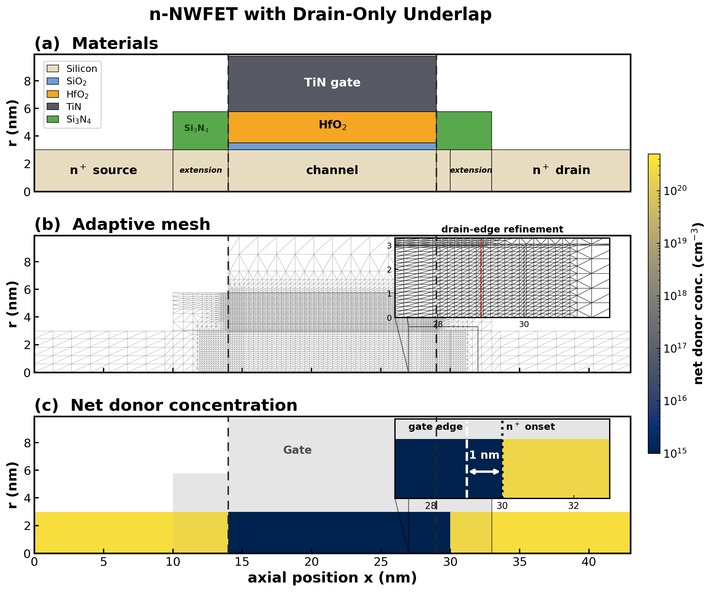
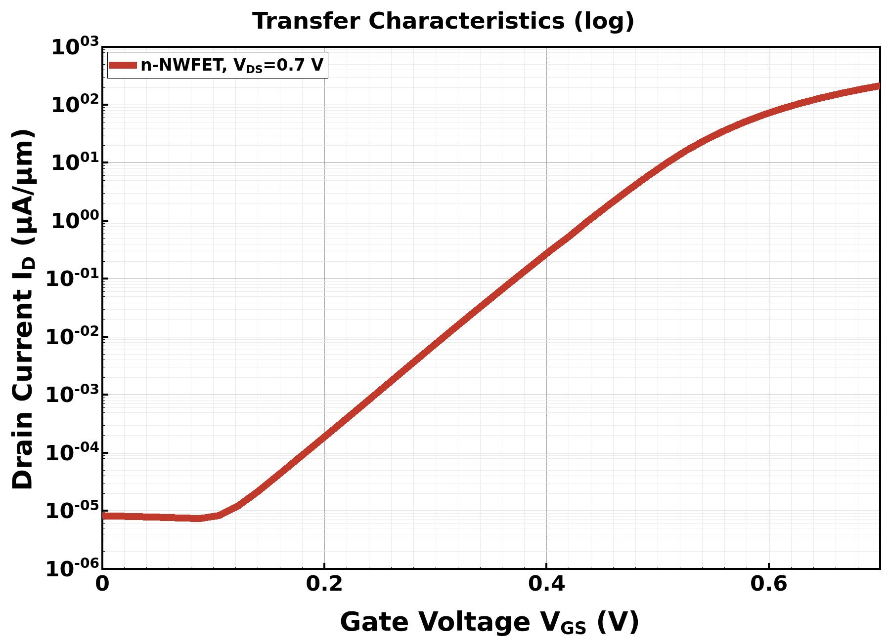
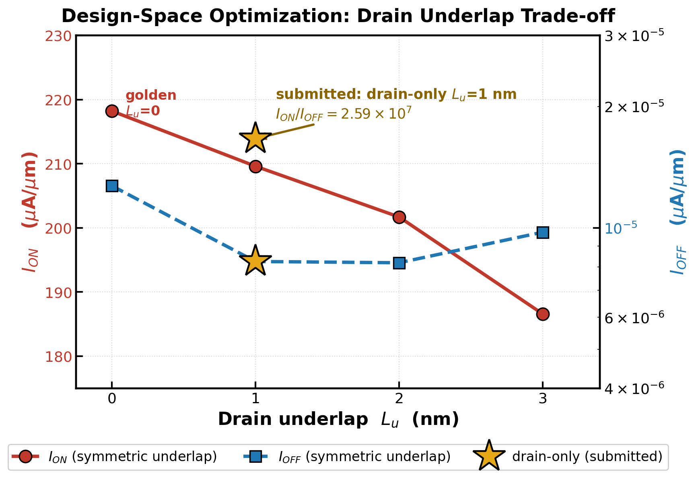

# Drain-Only Underlap in a Strained 15 nm Gate-All-Around Nanowire FET

**A 1 nm drain-side underlap cuts off-state leakage by 35% for a 2% on-current cost, raising ION/IOFF from 1.72 × 107 to 2.59 × 107 at VDD = 0.7 V.**

> **Status.** This device was my individual entry to the **IEEE Electron Devices Society TCAD Hackathon 2026**, where it placed in the **top three** internationally ([IEEE EDS competitions](https://eds.ieee.org/education/competitions)). This repository documents the device, method and results. Simulation decks, meshes and raw data are **not released** (see [What is not released](#what-is-not-released-and-why)).
>
> This work may be submitted to the IEEE for possible publication. Copyright may be transferred without notice, after which this version may no longer be accessible.

<em>Figure 1. (a) Materials of the cylindrical n-channel nanowire FET. (b) Adaptive mesh with refinement at the drain-side gate edge. (c) Net donor concentration; the inset shows the 1 nm undoped strip that sets the drain junction back from the gate edge.</em>

---

## 1. Motivation

At a 15 nm gate length, off-state current in a gate-all-around (GAA) nanowire is no longer set only by subthreshold diffusion. Band-to-band tunneling at the drain-side gate edge, where the gate-to-drain field peaks, adds a leakage component that grows as junctions become more abrupt. Spacer underlap moves the junction away from the gate and lowers this field, but a symmetric underlap also adds series resistance on the source side, which costs drive current.

The question this project answers: **can the junction be set back only where the leakage is generated, the drain side, and keep the source side intact?**

## 2. Device

A 2D cylindrical cross-section is revolved about the nanowire axis, so the simulation represents a full 3D cylindrical nanowire.

| Parameter | Value |
|---|---|
| Channel | Silicon nanowire, radius 3 nm (diameter 6 nm) |
| Gate length LG | 15 nm |
| Inner spacer | 4 nm Si3N4 |
| Source/drain epitaxy | 10 nm |
| Gate stack | 0.5 nm SiO2 interfacial layer + 2.26 nm HfO2 (k = 22), EOT 0.9 nm |
| Gate metal | TiN, work function 4.4 eV |
| Contacts / extensions | As 3 × 1020 cm−3 / As 2 × 1020 cm−3 |
| Channel | Undoped (B 1 × 1015 cm−3) |
| Stress | 1 GPa uniaxial tensile along the transport direction |
| **Design change** | **1 nm undoped strip at the drain-side gate edge** (drain junction set back 1 nm); source doped up to the gate edge |

## 3. Method

Simulations were run in **Synopsys Sentaurus** (Structure Editor and Sentaurus Device) at 300 K, using drift-diffusion transport with:

- **Quantum confinement:** density-gradient quantum potential for electrons, applied in silicon only.
- **Mobility:** doping-dependent and transverse-field (Enormal) degradation, with high-field velocity saturation driven by the quasi-Fermi gradient.
- **Strain:** piezoresistive mobility tensor (Kanda model) for the low-field mobility, plus deformation-potential shifts of the band edges, both driven by the 1 GPa stress. Velocity saturation is deliberately left stress-independent, so the reported peak velocity remains physical.
- **Leakage:** Hurkx band-to-band tunneling and doping-dependent Shockley-Read-Hall recombination.
- **Band structure:** Fermi statistics and Slotboom bandgap narrowing.

**Mesh.** The mesh is refined at the drain-side gate edge (Figure 1b), where the band-to-band generation rate peaks. Every doping profile was checked region by region in the meshed structure before any electrical run.

**Metrics** (all at VDS = 0.7 V). ION is taken at VGS = 0.7 V and IOFF at VGS = 0. Peak transconductance is read from the transfer curve, and maximum electron velocity from the on-state solution. Currents are normalized to the nanowire circumference, Weff = πd = 18.85 nm.

## 4. Results

### 4.1 Submitted device

| Metric (VDS = 0.7 V) | Absolute | Normalized |
|---|---|---|
| ION (VGS = 0.7 V) | 4.03 µA | 213.9 µA/µm |
| IOFF (VGS = 0) | 1.56 × 10−13 A | 8.25 pA/µm |
| Peak gm | 30.6 µS | 1.62 mS/µm |
| Maximum electron velocity | 1.07 × 107 cm/s | |
| **ION/IOFF** | **2.59 × 107** | |

<em>Figure 2. Transfer characteristic of the submitted device at VDS = 0.7 V.</em>

### 4.2 Effect of the drain-only underlap

Relative to the same device without underlap (Lu = 0):

| | Change |
|---|---|
| ION | −2.0% |
| **IOFF** | **−35%** |
| **ION/IOFF** | **+51%** (1.72 × 107 → 2.59 × 107) |
| Peak gm | −0.5% |
| Peak electron velocity | ≈ 0 |

### 4.3 Design space

| Underlap | ION/IOFF |
|---|---|
| None (Lu = 0) | 1.72 × 107 |
| Symmetric, 1 nm | 2.54 × 107 |
| Symmetric, 2 nm | 2.46 × 107 |
| Symmetric, 3 nm | 1.91 × 107 |
| **Drain-only, 1 nm (submitted)** | **2.59 × 107** |

<em>Figure 3. Symmetric underlap trades on-current for leakage, and past 2 nm the leakage gain reverses. Drain-only underlap (star) keeps most of the on-current, because the source-side series resistance is unchanged.</em>

**Interpretation.** The leakage reduction comes from the drain side, where moving the junction 1 nm away from the gate edge lowers the peak lateral field and therefore band-to-band generation. The on-current penalty of a symmetric underlap comes mainly from the source side, where the undoped strip adds series resistance in front of the injection point. Underlapping only the drain separates the two effects.

### 4.4 Levers that did not help

These are reported because they bound the design space:

- **High-k spacer without underlap:** IOFF rose about 9×. A high-k spacer is only worth considering together with an underlap.
- **Graded junctions:** in a 15 nm channel, the gain in leakage was outweighed by worse drain-induced barrier lowering.

## 5. Limitations

- This is a drift-diffusion study with a density-gradient correction, not a full quantum-transport (NEGF) calculation, so ballistic and source-to-drain tunneling effects in a 15 nm channel are approximated.
- The device is an idealized single nanowire. Parasitic capacitance, contact resistance beyond the doped regions, and process variability are not modeled.
- Results are simulated only and have not been fabricated or measured.

## What is not released, and why

The Sentaurus structure and device decks, meshes and raw I-V data are not published. The work may be developed into a manuscript, and the input files depend on licensed Synopsys TCAD tools and material libraries. The device parameters, physical models and results above are enough to understand and assess the work. Further detail is available on request.

## Author

**Tushar Dudeja**, B.Tech. Electronics Engineering (VLSI Design), Vellore Institute of Technology
[LinkedIn](https://linkedin.com/in/tushardudeja) · [GitHub](https://github.com/thetushardudeja1)

© 2026 Tushar Dudeja. All rights reserved. Figures and text may not be reused without permission.
